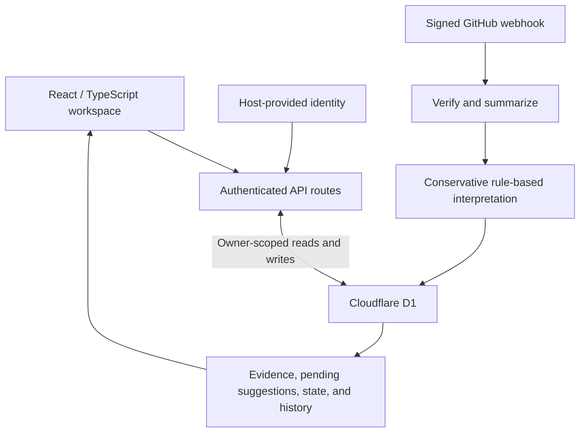

# Project Brain: Engineering Overview

The central design problem is deciding what a project event means without turning an uncertain interpretation into an unreviewable fact. Project Brain separates incoming evidence, pending suggestions, accepted state, and corrections.

[Product overview](README.md) · [Hosted app](https://project-brain.joezhuzc.chatgpt.site)

## Architecture

The UI uses React and Tailwind CSS. Next.js-style route handlers run through Vinext on Cloudflare Workers. D1 supplies SQLite persistence, with Drizzle schema definitions and migrations.

The hosted application relies on its hosting platform's authenticated identity boundary. Workspace routes resolve identity on the server and scope access to the owner; browser-supplied bearer tokens are not the source of identity.

## 1. Verify before interpreting

Webhook ingestion checks the signature against the unmodified request bytes before parsing JSON. It also checks the selected repository, binds its numeric repository ID on a valid delivery, and verifies that ID on subsequent requests.

The receiver bounds request size and accepts supported GitHub event types. It retains a short summary, source URL, delivery identifier, and timestamps rather than full payloads or repository code.

A connection is only treated as having received activity after a valid signed delivery. Preparing its configuration alone does not establish that the integration works.

**Trade-off:** keeping summaries limits stored data and makes the feed readable, but this is event ingestion rather than a complete repository mirror or historical import.

## 2. Make duplicate deliveries harmless

A unique connection-and-delivery-ID constraint deduplicates repeated webhook notifications. Dependent inserts are conditional on the newly inserted receipt.

The receipt, connection update, timeline event, evidence, and any suggestion are written in one transactional D1 batch. A repeated delivery does not create another copy of the history. A persistence failure should leave the related records uncommitted together.

This handles delivery retries without making an exactly-once transport claim.

## 3. Keep evidence separate from accepted state

The interpretation layer currently uses conservative deterministic matching:

- A push creates evidence without a state-change suggestion.
- A merged pull request or closed issue may suggest Implemented when it safely matches a tracked capability.
- Ambiguous significant activity asks the user to select a capability.
- A release requests review rather than proving Shipped.
- New activity against a Paused or Dropped capability prompts a review of the earlier decision.

Suggestions retain their evidence, rationale, and confidence. The user can edit the proposed item or state before applying it, or ignore it. Applying a suggestion updates state and appends linked history in a batch; resolution checks prevent the same pending suggestion from being applied twice.

**Trade-off:** explicit review creates some work for the user, but keeps an uncertain inference from silently rewriting project reality. GitHub activity does not independently complete Missions or select the Next Action.

## 4. Preserve the ability to correct a record

Quick Capture creates a structured draft that the user confirms before saving. Capture and Timeline writes share a transaction.

Corrections preserve the original capture text and append before/after snapshots, a reason, a revision, and a timestamp. Revision checks and conditional writes reject stale edits with a conflict response. The correction and its history are committed together.

**Trade-off:** revision conflicts require a refresh and review, but avoid silently losing a concurrent correction or rewriting the audit trail.

## Validation

**Local verification on October 30, 2026: 38 tests passed; 0 failed.**

The private test suite runs the actual route code with an isolated authentication adapter and an in-memory SQLite adapter for the D1 interface. All database migrations are applied to the test database. A mocked persistence failure exercises rollback.

| Boundary | Representative checks |
| --- | --- |
| Authentication | Missing identity stops access; other users remain isolated; expired sessions do not automatically replay writes. |
| Webhooks | Altered payloads, wrong signatures, repository mismatches, and changed numeric repository IDs are rejected. |
| Delivery consistency | Concurrent duplicate deliveries do not duplicate history; injected failures roll back related writes. |
| Review semantics | A merged PR creates a pending suggestion; pushes remain evidence; a release does not prove shipment. |
| Corrections | Original text survives; before/after history and reasons are retained; stale concurrent corrections conflict. |
| Product state | Notes and GitHub activity do not silently complete Missions or change the explicit Next Action. |

These checks validate local application logic under the test adapters. They are not a production load test or proof of a live GitHub webhook connection.

## Scope and ownership

I designed and implemented the product interface, API routes, data model, webhook ingestion, review workflow, correction history, and tests.

The source repository and user workspaces remain private. This public repository provides a product overview and engineering explanation, without implementation files, credentials, or workspace records.

