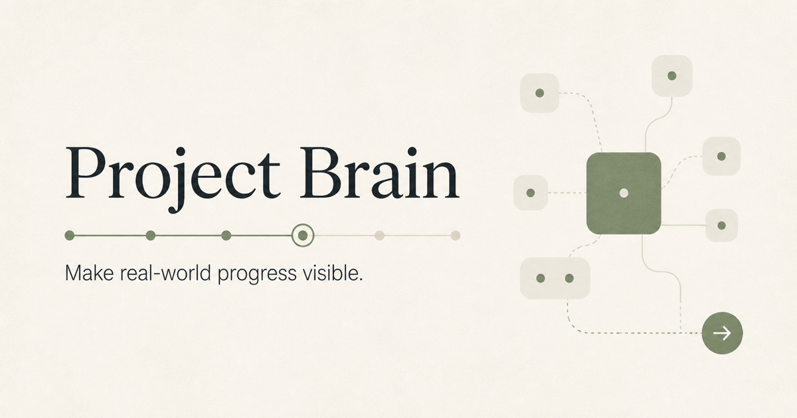
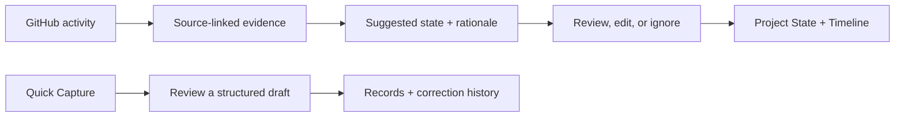

  

# Project Brain

**A project-state workspace for independent developers: connect what happened to what is actually built.**

Project Brain organizes notes and GitHub activity into evidence-linked project records. It helps a developer return to a project, see recent changes, review uncertain interpretations, and decide what to do next.

[Open Project Brain](https://project-brain.joezhuzc.chatgpt.site) · [Engineering overview](ENGINEERING.md)

The hosted app requires sign-in. This repository is a public product and engineering showcase; the application source remains private.

## Why I built it

Progress gets scattered across commits, issues, decisions, and unfinished ideas. A merged pull request might mean a feature is implemented, but it does not prove users received it. A note about something to consider later is not a decision.

I built Project Brain to keep those distinctions visible and make every suggested state change reviewable.

## How it works

| Area | What the current implementation does |
| --- | --- |
| Overview | Shows **Since You Last Checked** and **Needs Your Attention** so recent evidence and pending decisions are easy to find. |
| Project State | Tracks capabilities through states such as Idea, Building, Implemented, Shipped, Blocked, and Paused. Suggestions include a source link, rationale, and confidence. |
| Quick Capture | Turns a short note into a rule-based Idea, Decision, or Progress draft for the user to confirm before saving. |
| Records and corrections | Preserves original notes and appends revisioned corrections with before/after values, a reason, and history. |
| Chapters and actions | Organizes bounded goals and keeps one explicitly selected Next Action. |
| GitHub connection | Receives signed push, pull-request, issue, and release webhooks; retains concise event summaries and source links. |

### Example: implementation is not shipment

*Illustrative example, not real project activity.*

A tracked capability called **Purchase restoration** is Building. A related pull request is merged. Project Brain retains the source event and may suggest **Implemented** with an explanation. The user can change the target capability or proposed state, apply it, or ignore it.

A later GitHub Release creates a review item; it does not automatically mark the capability **Shipped**. Ordinary pushes are recorded as evidence without generating a state-change suggestion.

## Engineering highlights

- **Verified ingestion:** HMAC-SHA256 verification over raw webhook bytes, repository checks, and owner-scoped workspace operations.
- **Consistent history:** delivery-ID deduplication and transactional D1 batches keep receipts, evidence, suggestions, and timeline records together.
- **Explicit review:** evidence and proposed interpretations are stored separately from accepted project state.
- **Recoverable corrections:** original capture text remains intact; revision checks reject stale edits instead of silently overwriting another correction.
- **Tested boundaries:** 38 automated tests passed on October 30, 2026, covering authentication, user isolation, signature validation, duplicate deliveries, rollback, and review behavior. See the [validation details](ENGINEERING.md#validation).

**Stack:** React, TypeScript, Tailwind CSS, Cloudflare Workers, D1 (SQLite), and Drizzle schema/migrations. The application uses Next.js-style routes through Vinext.

## My role

I am the founder and solo full-stack developer. I designed the product workflow, built the React/TypeScript interface and API routes, modeled persistence, implemented the GitHub integration and correction history, and wrote the automated tests.

## Current scope

The current interpretation layer uses deterministic rules. AI-based interpretation and historical repository import are future work. The showcase describes implemented behavior rather than the broader product roadmap.

The repository contains documentation and a public brand image only. See [NOTICE](NOTICE.md).

