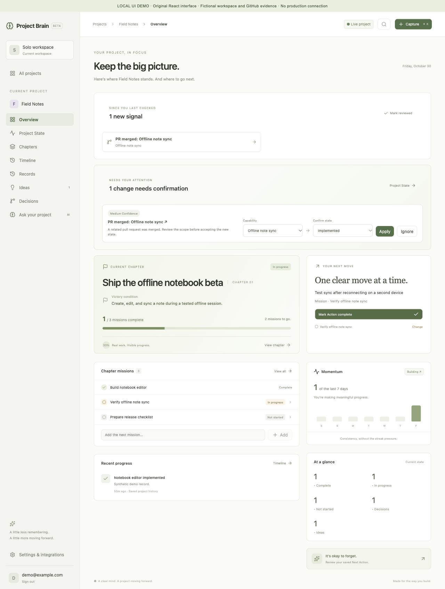
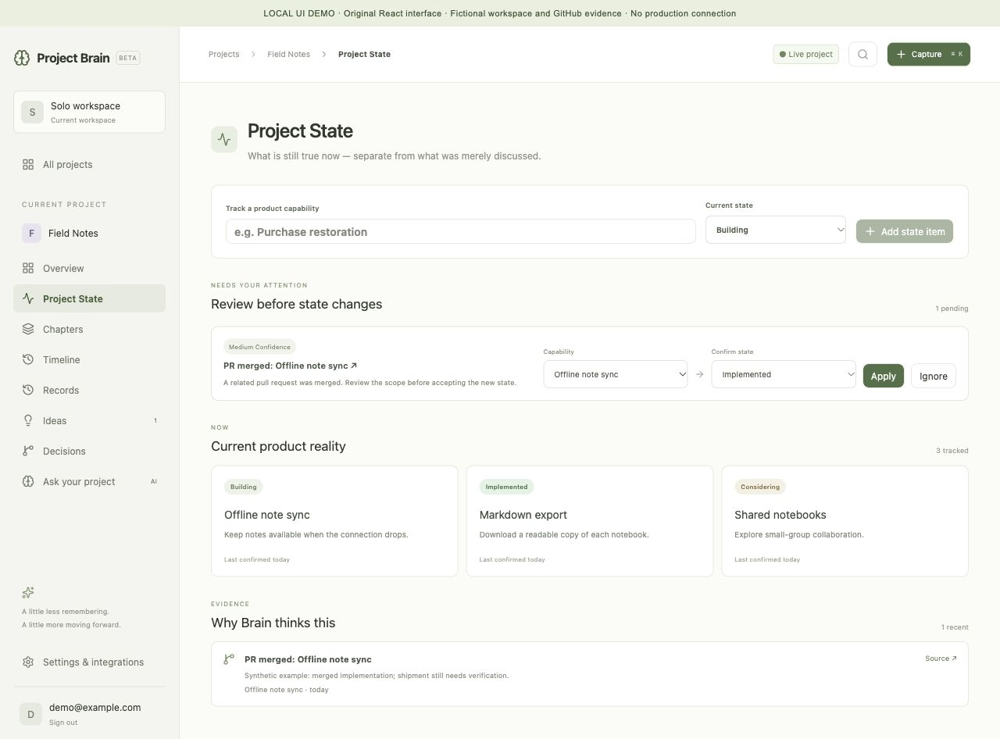
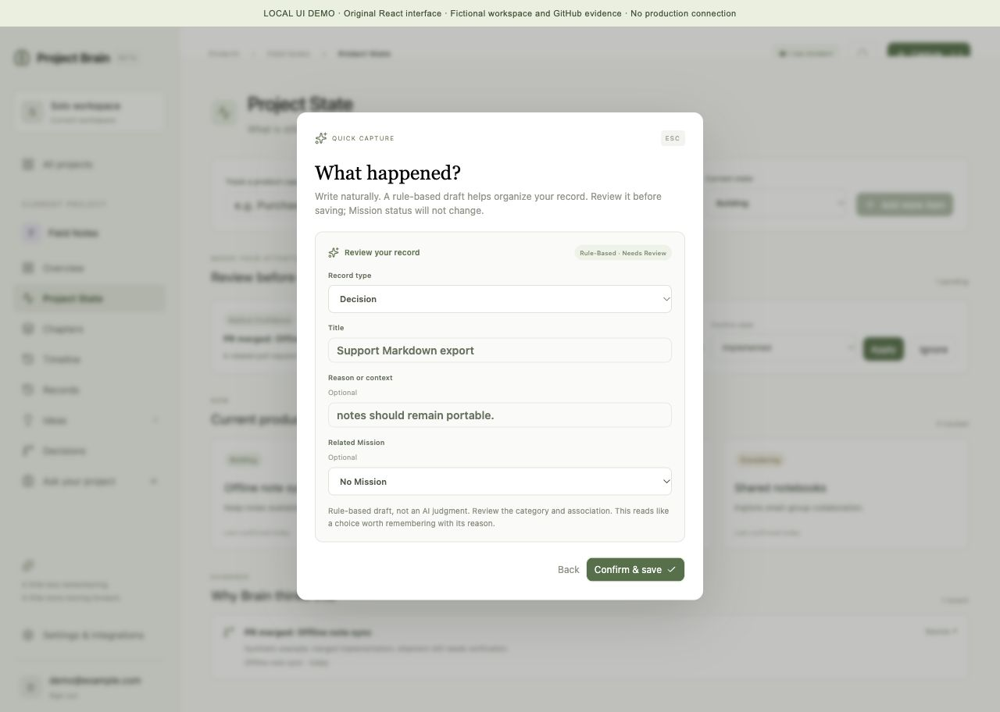

# Interface walkthrough

[Project overview](README.md) · [Engineering overview](ENGINEERING.md)

Captured on October 30, 2026, from the existing React interface in an isolated local preview. **Field Notes**, its records, account, and PR evidence are fictional. A local API adapter supplies fixtures; there is no production connection. The disclosure ribbon identifies the demo. The underlying application components and styling are used, with layout offsets to accommodate that ribbon.

## 1. Return to the project

The Overview brings recent evidence, pending review, the current chapter, and one selected Next Action together. In this example, the developer is preparing an offline notebook beta and needs to test reconnect behavior on a second device.

## 2. Review evidence before accepting state

The synthetic merged PR proposes **Implemented** for **Offline note sync**, while its accepted state remains **Building**. The review card exposes the capability, proposed state, confidence, and rationale; the source evidence stays visible below.

The screenshot shows the review controls. Applying or ignoring the suggestion was not exercised in this isolated preview; persistence and webhook validation are covered separately in the [engineering validation](ENGINEERING.md#validation).

## 3. Turn a note into a draft

Input: “We decided to support Markdown export because notes should remain portable.”

The existing deterministic capture analyzer produces a **Decision** draft with a title and reason. The user can edit its type, wording, and Mission association before confirming.

This capture was analyzed and reviewed locally, without saving a record or changing a Mission. The interface labels it as rule-based; the **AI** navigation label is not evidence of a connected AI service.

## What these images establish

They show the implemented interface and the local draft-review interaction. They do not demonstrate a live webhook delivery, production write, or AI integration. The public repository contains screenshots and documentation only; application source and real workspace content remain private.
